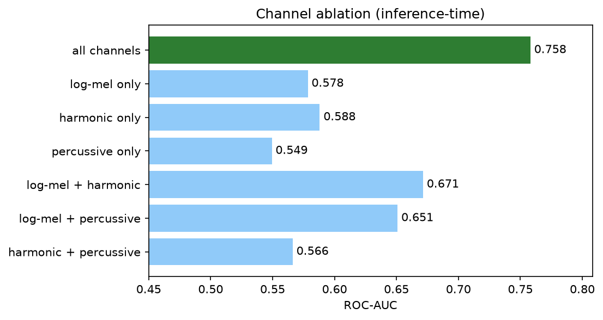
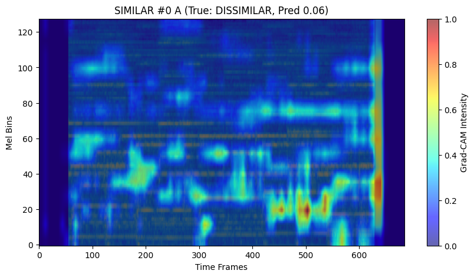
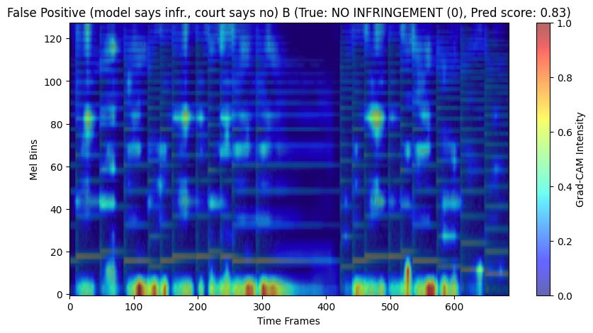
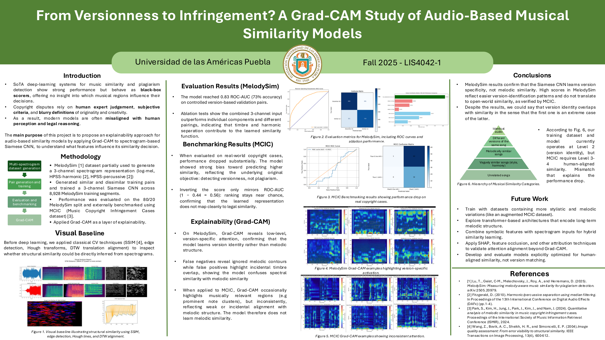
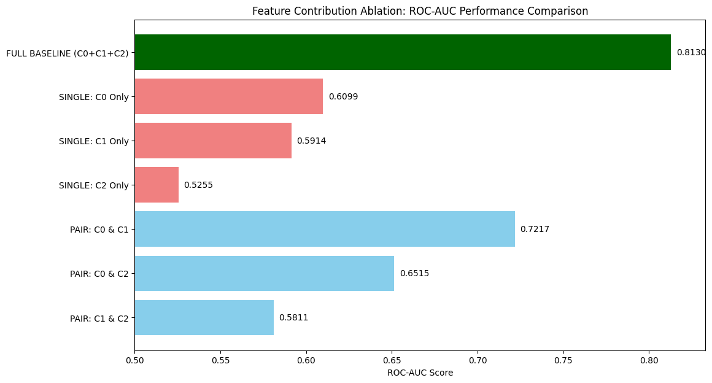
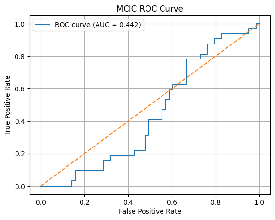

# From Versionness to Infringement?
### A Grad-CAM study of audio-based musical similarity models

[](https://github.com/DJ-lezama/grad-cam-music-similarity/actions/workflows/tests.yml)
[](https://colab.research.google.com/github/DJ-lezama/grad-cam-music-similarity/blob/main/notebooks/walkthrough.ipynb)
[](LICENSE)

**Question:** when a deep audio-similarity model says two songs are "similar", *what is it actually looking at*, and does
that match what matters in a music-copyright dispute?

**Approach:** train a Siamese CNN on 3-channel spectrograms (log-mel + HPSS harmonic + HPSS percussive) from
[MelodySim](https://huggingface.co/datasets/amaai-lab/melodySim), test it on real court cases from MCIC, and use
**Grad-CAM** to see which time-frequency regions drive its decisions.

**Finding:** the model learns **version identity** (recognising re-arrangements of the *same* segment), not melodic
similarity. It generalises moderately to unseen MelodySim tracks (ROC-AUC **0.76**) but is at chance on real copyright
cases (ROC-AUC **0.45**), scoring *every* court case as similar, and Grad-CAM shows attention on low-level,
rendition-specific texture rather than melodic contour.

**Quick links:** [results](#results) · [Grad-CAM](#grad-cam) · [method](#method) · [reproduce](#reproducing) ·
[walkthrough notebook](notebooks/walkthrough.ipynb) · [background: course project & poster](#background-the-original-course-project)

> This repository is an extended version of a Fall 2025 course project. The current results below come from
> re-evaluating the trained model with this codebase; the original poster and its numbers are kept in
> [Background](#background-the-original-course-project).

---

## Results

All numbers use the trained checkpoint from [release v1.0](https://github.com/DJ-lezama/grad-cam-music-similarity/releases/tag/v1.0).

| evaluation | pairs / cases | ROC-AUC | accuracy @ 0.5 |
|---|---|---|---|
| **MelodySim test split** (100 tracks never seen in training or model selection) | 9,751 fixed pairs | **0.758** | 0.684 |
| **MCIC copyright cases**, middle ~11 s of each song | 96 | **0.450** | 0.333 |
| **MCIC copyright cases**, best-matching ~11 s windows | 96 | **0.397** | 0.333 |

**MelodySim (in-domain).** The model separates two versions of the same segment from segments of different tracks
clearly above chance (precision 0.72 / recall 0.60 for *similar*). The **channel ablation** (channels zeroed at inference,
no retraining) shows that no single view carries the decision: all three channels 0.758 · log-mel + harmonic 0.671 ·
log-mel + percussive 0.651 · harmonic 0.588 · log-mel 0.578 · harmonic + percussive 0.566 · percussive 0.549.

 

**MCIC (real court cases).** Every one of the 96 pairs scores between 0.61 and 0.87, whatever the court decided: the model
treats any two MIDI renderings as "versions" of each other. Comparing the best-matching windows instead of the middle of
each song makes the ranking *worse* (0.397), which supports the conclusion that the signal is shared rendering texture,
not melody. (Cases 31 and 57 are not scored: they have no rendered audio and need the FluidR3_GM soundfont.)


## Grad-CAM

Grad-CAM back-propagates the similarity logit to the last conv layer of each branch, giving one heat map per input.

Held-out test pair, two versions of the same segment, scored 0.85 similar: the heat sits on different, unaligned regions in
each branch rather than following a melodic line.


| MelodySim, similar pair | MCIC, false positive (court: no infringement) |
|---|---|
|  |  |
|  |  |

* **MelodySim:** attention is scattered over note onsets and dense spectral spots and is not aligned between the two
  versions: evidence of version-specific cues, not melodic structure.
* **Errors:** misses ignore melodic contours; false alarms highlight incidental timbre overlap.
* **MCIC:** occasionally highlights musically relevant note clusters, but inconsistently.

## Interpretation

Musical similarity forms a hierarchy: *identical audio* → *different versions of the same song* → *melodically similar
songs* → *vaguely similar (style, harmony)* → *unrelated*. The training pairs only test level 2 (versionness), while legal
similarity lives at levels 3–4. A model can therefore score well in-domain while learning nothing that transfers to
copyright judgements, and explainability methods make that mismatch visible.

## Method

```
audio (≈9 s @16 kHz)
  └─ log-mel (128 × T) ─┬─ min-max ───────────────┐
                        └─ HPSS ─┬─ harmonic ──────┤→ (3, 128, 685) multispec
                                 └─ percussive ────┘
two multispecs ─► shared CNN encoder ─► |z_a − z_b| ─► MLP ─► similarity logit
                          └─ last conv maps ─► Grad-CAM heat map per input
```

| Step | Details |
|---|---|
| Visual baseline | Spectrograms as images: CLAHE, directional median filters, Canny, Hough lines, SSIM, multi-dimensional DTW |
| Data | 103 MelodySim shards → 28,826 segments, 351 tracks; splits taken from each segment's path. Training used 8,928 training segments |
| Pairs | positive = same segment in two different versions; negative = segments from different tracks |
| Model | 4 conv blocks (16→128 ch), GAP, 256-d L2-normalised embedding, MLP on \|z_a − z_b\| (≈164 k params) |
| Training | BCE, Adam lr 1e-4, ReduceLROnPlateau, early stopping on validation loss (best at epoch 10 of 18) |
| Evaluation | fixed, seeded pairs on the held-out test split; inference-time channel ablation; MCIC court cases |
| Explainability | Grad-CAM on the similarity logit, one map per branch |

## Reproducing

```bash
git clone https://github.com/DJ-lezama/grad-cam-music-similarity.git
cd grad-cam-music-similarity
python -m venv .venv && source .venv/bin/activate
pip install -r requirements.txt
```

**1. Trained weights** (≈0.7 MB): download `siamese_best.pt` from the
[latest release](https://github.com/DJ-lezama/grad-cam-music-similarity/releases) into `checkpoints/`.

```bash
gh release download --repo DJ-lezama/grad-cam-music-similarity -p siamese_best.pt -D checkpoints
```

**2. MelodySim** (public, CC-BY 3.0). The full set used here is ~50 GB. `--split test` fetches only the 35 shards
holding the test split (~17 GB), and `--quick N` only the first N shards (~0.5 GB each) for a fast end-to-end check.

```bash
python scripts/download_melodysim.py --split test
python scripts/preprocess_melodysim.py --delete-parquets   # ~5 GB of spectrograms; parquets removed as processed
```

**3. MCIC** (optional). Place the dataset in `data/mcic/` as `MCIC-ISMIR2024.csv` plus either rendered WAVs in
`data/mcic/AUDIO/` or MIDI files in `data/mcic/MIDI FILES/` (rendered with FluidSynth: pass a General MIDI soundfont such
as FluidR3_GM via `--soundfont`).

**4. Run**

```bash
python scripts/evaluate_melodysim.py --split test --ablation   # metrics + ablation on held-out test pairs
python scripts/gradcam_examples.py --split test                # Grad-CAM overlays
python scripts/benchmark_mcic.py --mode center                 # MCIC, middle window of each song
python scripts/benchmark_mcic.py --mode max-window             # MCIC, best-matching windows
python scripts/train.py                                        # retrain from scratch (GPU recommended)
```

Or open [`notebooks/walkthrough.ipynb`](notebooks/walkthrough.ipynb) (locally or
[in Colab](https://colab.research.google.com/github/DJ-lezama/grad-cam-music-similarity/blob/main/notebooks/walkthrough.ipynb)),
which shows the saved results and re-runs each step when data and weights are present.
Set `MUSICSIM_DATA=/path/to/data` to keep the large files elsewhere (e.g. on Google Drive in Colab).

**Tests:** `pip install -e ".[dev]" && pytest` runs fast checks (no data needed) of preprocessing, pairing, the model,
Grad-CAM and MCIC scoring; they also run on every push via GitHub Actions.

## Repository layout

```
src/musicsim/
  audio.py            log-mel + HPSS → 3-channel multispec
  melodysim.py        shard download, preprocessing, manifest
  pairs.py            training / fixed evaluation pair datasets
  model.py            Siamese CNN, checkpoint loading
  train.py            training loop
  evaluate.py         metrics and channel ablation
  gradcam.py          Grad-CAM for both Siamese branches
  mcic.py             MCIC loading, MIDI rendering, center / max-window scoring
  visual_baseline.py  classical CV baseline
  plots.py            figures
scripts/              command-line entry points
notebooks/            walkthrough
tests/                fast pytest checks (no data needed)
data/                 shard list + reference manifest of the original run (large data is git-ignored)
docs/figures/         result figures (test_* = current results, fig* = original course run)
docs/poster/          course poster (corrected PDF + PNG), original PDF, correction script
```

## Limitations

* HPSS is applied to the shifted dB log-mel rather than a linear spectrogram; kept for compatibility with the checkpoint.
* MCIC songs are MIDI renderings with one soundfont, while MelodySim is rendered audio with varied instrumentation.
* Grad-CAM at the last conv layer has coarse resolution (1/8 of the input in each axis).
* The ablation zeroes channels of a model trained on all three; it measures reliance, not what a single-channel model
  could learn.

## Future work

* Train on pairs with stylistic and melodic variation (e.g. augmented MCIC-like data) rather than versions only.
* Sequence models (transformers) that encode long-range melodic structure.
* Combine symbolic (MIDI / pitch contour) features with spectrogram input.
* Check attribution with SHAP and occlusion in addition to Grad-CAM.
* Optimise directly for human-aligned similarity rather than version matching.

---

## Background: the original course project

**Fall 2025:** course project for *Artificial Vision* (LIS4042) at Universidad de las Américas Puebla, presented as the
poster below. The audio/music side of the project was designed and carried out independently.
**2026:** extended independently into this repository: restructured into a tested Python package, evaluation issues
fixed, the trained model re-evaluated on MelodySim's held-out test split and on MCIC with a new scoring mode, and
Colab / CI support added. The model, preprocessing and checkpoint are the same as in the course version.

### Poster

[](docs/poster/poster.pdf)

<sub>Click for the PDF. Typos and two statements are corrected relative to the poster as presented
([original](docs/poster/poster_original.pdf)): the validation result is reported as ROC-AUC 0.83 / 73 % accuracy (the
original said ">80 % accuracy"), the training-set size is 8,928 segments, and the "flipped score" bullet explains that
inverting the score only mirrors ROC-AUC. The edits are scripted in [`fix_poster.py`](docs/poster/fix_poster.py).</sub>

### Original results (course version)

These were computed in the original Colab notebook on the **validation** split, which was also used for early stopping,
with evaluation pairs re-sampled on every pass; the [current results](#results) above supersede them.

| | course version | this repository |
|---|---|---|
| MelodySim split | validation, 2,099 re-sampled pairs | **test**, 9,751 fixed pairs |
| MelodySim ROC-AUC / accuracy | 0.833 / 0.732 | **0.758 / 0.684** |
| Ablation, all channels → best pair → best single | 0.813 → 0.722 → 0.610 | 0.758 → 0.671 → 0.588 |
| MCIC cases scored | 95 | 96 |
| MCIC ROC-AUC (middle window) | 0.442 | 0.450 |

 
 

### What changed from the course notebook

| Issue in the original notebook | Effect | Now |
|---|---|---|
| Evaluation pairs were re-sampled at random on every pass | metrics varied between runs (0.833 vs 0.813 ROC-AUC on the same split) | fixed, seeded pairs (`FixedPairs`) |
| A segment with no other version available was paired with itself as a "positive" | identical inputs counted as easy positives | such anchors are skipped |
| Validation split used both for early stopping and for the reported metrics; test split unused | optimistic estimate | evaluation on the held-out test split |
| MCIC loop thresholded the raw **logit** at 0.5 (named `prob`) | confusion matrix used a different cut-off than intended (ROC-AUC unaffected) | sigmoid applied before thresholding |
| MCIC scored only the middle ~11 s of each full song | the disputed passage may not be in that window | optional `max-window` scoring |
| MCIC file names with apostrophes / dots did not match the files on disk | 3 cases skipped | 1 recovered (2 still need a soundfont) |
| Training data depended on how many files a Colab session managed to copy locally | training set size varied between sessions | manifest-driven; missing files are reported |
| Visual baseline passed a 0–255 image as dB to HPSS | meaningless HPSS view | operates on the dB spectrogram |

Note on the poster's "flipped score" check: reversing the score gives ROC-AUC = 1 − 0.442 = 0.558 by definition, so it
does not add information beyond "the ranking is close to chance".

## References

1. T. Lu, C.-M. Geist, J. Melechovsky, A. Roy, D. Herremans. *MelodySim: Measuring melody-aware music similarity for
   plagiarism detection.* arXiv:2505.20979, 2025.
2. D. FitzGerald. *Harmonic/percussive separation using median filtering.* DAFx, 2010.
3. S. Park, H. Kim, J. Jung, J. Park, J. Kim, J. Nam. *Quantitative analysis of melodic similarity in music copyright
   infringement cases.* ISMIR, 2024.
4. Z. Wang, A. C. Bovik, H. R. Sheikh, E. P. Simoncelli. *Image quality assessment: From error visibility to structural
   similarity.* IEEE TIP 13(4), 2004.
5. R. R. Selvaraju et al. *Grad-CAM: Visual explanations from deep networks via gradient-based localization.* ICCV, 2017.

Code is MIT-licensed ([LICENSE](LICENSE)). Datasets are not redistributed here; see their own licences. MelodySim is
CC-BY 3.0.
